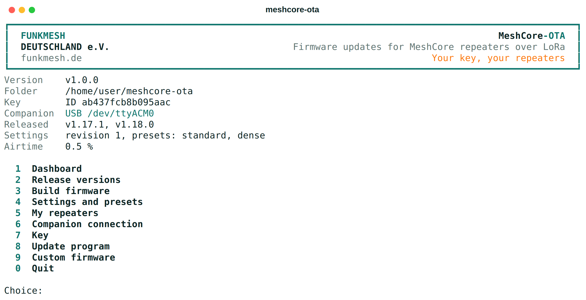
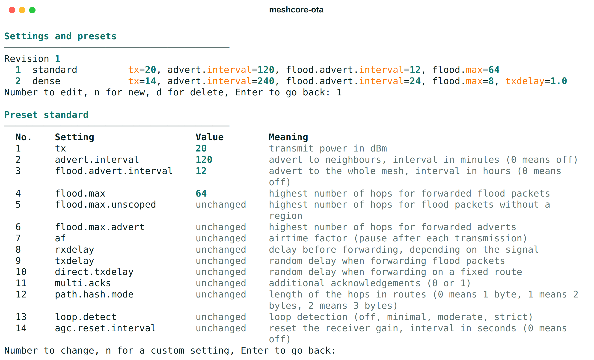
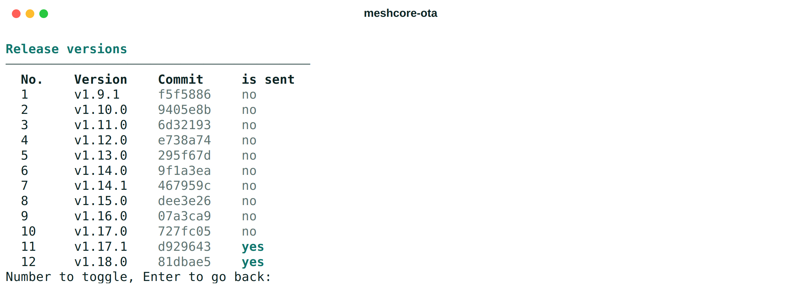
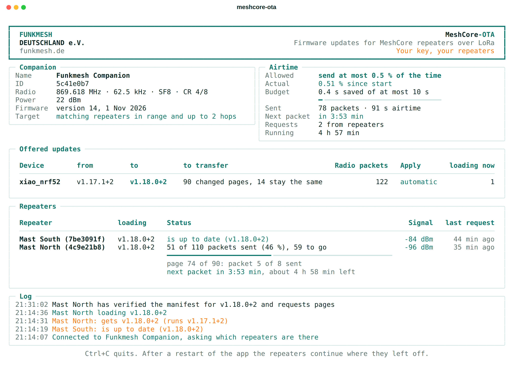

# MeshCore-OTA

Firmware updates for MeshCore repeaters over LoRa, signed with the operator's own key.

> **Quickstart:** [from the download to the first update over the air in seven steps](docs/quickstart.md)

A project of [Funkmesh Deutschland e. V.](https://funkmesh.de), open source under the GNU General Public License, version 3.



## What it does

MeshCore-OTA is meant for operators who run their own MeshCore repeaters in places that are hard to get to. It consists of two parts:

- an addition to the MeshCore repeater firmware that receives updates over the air, verifies them, applies them and passes them on to neighbours,
- the program `meshcore-ota` for Linux and Windows, which builds this firmware, signs updates and sends them through an ordinary companion.

There is no central key. Each operator signs with their own Ed25519 key, and their repeaters only accept updates signed with it.

## How it works

1. `meshcore-ota` builds the repeater firmware from the MeshCore source code and embeds the operator's public key and presets. This firmware is installed on the repeater once, over Bluetooth or USB.
2. For every later version the program builds the firmware again and computes the difference to the running one. Only this difference is transferred, split into pages of 4 KB. Pages that stay the same cost no airtime.
3. The computer sends through a companion (USB or Bluetooth, ordinary companion firmware). It reaches repeaters in direct range and up to 2 hops beyond on a fixed route.
4. Each repeater verifies the signature of the manifest before it accepts any data, and every page against the manifest. It then passes the update on to its neighbours (zero-hop), only on request and with at most 0.5 % airtime.
5. The new firmware first runs on trial. If it does not confirm itself, the old one runs again after three trial boots.

Updates go step by step: a repeater only ever receives the next released version after the one it is running.

## Status

MeshCore-OTA is under active development. The radio protocol, the package format and the command line may still change between releases, and a newer release is not guaranteed to read packages built by an older one.

Supported are MeshCore repeaters based on the nRF52840 and on the ESP32 family. Boards based on the RP2040 or on STM32 are not supported.

## Getting started: from download to the first update over the air

### 1. Download the program

Download the file for your operating system from the [releases](https://github.com/funkmesh-deutschland/meshcore-ota/releases):

| Operating system | File |
| --- | --- |
| Linux (x86-64) | `meshcore-ota-linux` |
| Linux (ARM64, for example Raspberry Pi with a 64-bit system) | `meshcore-ota-linux-arm64` |
| Windows | `meshcore-ota-windows.exe` |

Put the file into a folder of its own, for example `meshcore-ota`. All data is later created right next to the program. On Linux, rename the file and make it executable:

```
mv meshcore-ota-linux meshcore-ota
chmod +x meshcore-ota
```

To build firmware, the computer needs an internet connection and, once, Python 3.9 or newer. On Windows install it from python.org, the entries from the Microsoft Store do not work. The program sets up the build tool PlatformIO itself during the first build (about 1 GB, a few minutes).

### 2. Start

```
./meshcore-ota
```

On Windows, start `meshcore-ota.exe` in a command prompt. Without a subcommand the menu opens. On first start the program creates the folders and a key pair.

The file `keys/signing.key` is secret. Whoever has it can install firmware on your repeaters. Keep a copy in a separate place.

### 3. Create presets (menu item 4)

A preset is a named list of MeshCore settings, for example transmit power and advert intervals. The presets are part of the firmware. The first preset in the list applies on every repeater until another one is selected there. If you do not want to prescribe any settings, skip this step.



### 4. Build firmware (menu item 3)

Select the MeshCore version and the device (search by part of the name, for example `xiao`). The program downloads the MeshCore source code, builds the firmware with your key and your presets and stores:

- in `firmware/` the build, for example `xiao_nrf52-v1.18.0+1.bin`. All later updates are derived from it. Keep this folder.
- in `install/` the files for the first installation.

If a selection of released versions has already been saved, the program asks at the end whether the version just built should be added.

### 5. Install the firmware

nRF52840:

| Method | File in `install/` | Procedure |
| --- | --- | --- |
| Bluetooth | `<device>-<build>-mcota.zip` | Run `start ota` on the repeater (log in as admin in the MeshCore app, command line). Then select the ZIP file in the app "nRF Device Firmware Update" and upload it. |
| USB serial | `<device>-<build>-mcota.zip` | With a DFU tool for the bootloader, for example `adafruit-nrfutil dfu serial --package <file>.zip -p /dev/ttyACM0 -b 115200 --touch 1200`. |
| USB drive | `<device>-<build>-mcota.uf2` | Press reset twice briefly, the device shows up as a drive. Copy the UF2 file onto it. |

ESP32:

| Method | File in `install/` | Procedure |
| --- | --- | --- |
| USB | `<device>-<build>-mcota-merged.bin` | Write with an ESP flasher starting at address 0. |
| Wi-Fi | `<device>-<build>-mcota.bin` | Run `start ota` on the repeater, connect to the Wi-Fi network `MeshCore OTA` and upload the file at `http://192.168.4.1/update`. |

The public key is already part of the firmware. No further step is needed on the repeater for it. Name, location, radio parameters and passwords are set on the device as with any MeshCore firmware.

### 6. Release versions (menu item 2)

The list shows the repeater versions of MeshCore. Only versions marked "yes" are sent out. Entering the number toggles a version.



### 7. Connect the companion (menu item 6)

The program shows serial ports and companions in Bluetooth range. Select the port and confirm the airtime (default 0.5 %). The MeshCore app must not be connected to the companion at the same time. For Bluetooth, the companion has to be paired with the computer beforehand.

### 8. Run the dashboard (menu item 1)

The dashboard asks over the air which of your repeaters are present. Each one reports its device type and running firmware. For each of them the program determines the next step, builds firmware and package if they are missing, signs and sends on request. Ctrl+C returns to the menu. After a restart of the program the repeaters continue where they left off.



As soon as a repeater has an update completely, it passes it on to its neighbours by itself. It applies the update on its own once no neighbour has loaded from it for half an hour, plus a random delay of up to another half hour.

After applying, the new firmware runs on trial until a neighbouring repeater or the dashboard answers it. Without an answer it restarts after ten minutes, and after three attempts the previous firmware runs again. Leave the dashboard running until the repeater shows the new build as confirmed. A repeater that has rolled back does not take the same update again until it receives `ota reset`.

At 0.5 % airtime a version step takes several hours per repeater, about nine hours at SF8, 62.5 kHz and CR 4/8. A higher airtime for the companion (menu item 6, up to 5 %) shortens the transfer from the computer.

Under menu item 5 (My repeaters) you add repeaters from the companion's contacts. For these the program discovers the route itself if they do not respond.

## Folders and files

All data is stored right next to the program: for the prebuilt executable in its directory, when started from source in the current directory. With `--dir <path>` everything is stored elsewhere.

| Folder or file | Contents |
| --- | --- |
| `keys/signing.key` | private key, secret |
| `keys/public.txt` | public key and key ID |
| `keys/retired-<id>.key`, `keys/retired.json` | retired keys after a key change |
| `firmware/<device type>-<version>+<revision>.bin` | firmware builds, the basis of all packages. Keep them |
| `firmware/<device type>.json` | memory layout of the device type |
| `firmware/keys.json` | which build was built with which key |
| `packages/` | signed packages (`.mcota`) |
| `install/` | files for the first installation |
| `downloads/` | optional: ZIP files from meshcore.io that specify a version |
| `cache/` | build tool, MeshCore sources, version list, build logs |
| `settings.json` | presets and their revision |
| `releases.json` | released versions |
| `repeaters.json` | your repeaters with the build they last reported |
| `config.json` | companion port, airtime, test mode |
| `custom.json` | firmware source and build flags |
| `sources/` | optional source folders, one per version |

The name of a build consists of the MeshCore version and the revision of the settings, for example `v1.18.0+3`.

## Keys and key change

The key pair is created on first start. Menu item 7 shows the ID of the active key.

An existing private key is imported with menu item 7 or

```
meshcore-ota key-import <file>
```

The file contains 32 bytes, raw or as 64 hex characters. If firmware built with the previous key already exists, the change works like this:

1. The previous key is moved to `keys/retired-<id>.key`.
2. The next update for repeaters with the previous key is signed with the previous key and contains the new one.
3. After that only the new key is valid on the repeater.

Keep the previous key until all repeaters have been switched over. Repeaters that cannot be reached over the air need the new base firmware (menu item 3). More in [docs/keys.md](docs/keys.md).

## Settings

Presets are lists of MeshCore `set <name> <value>` commands. Every change to a preset or to the key results in a new revision (`v1.18.0+3` becomes `v1.18.0+4`), which is sent out as a small update.

On the repeater, over USB or through admin access:

| Command | Effect |
| --- | --- |
| `ota preset` | shows the active preset and the list |
| `ota preset <name>` | selects a preset and applies it |
| `ota locksettings on` | the repeater keeps its values even if an update brings new ones |
| `ota locksettings off` | removes the lock |

More in [docs/settings.md](docs/settings.md).

## Updating the program

On start the menu checks GitHub in the background for a newer version and shows a notice if there is one. Menu item 8 or

```
meshcore-ota self-update
```

downloads the new executable and replaces only that file. Keys, firmware, packages and settings are kept. `meshcore-ota version` shows the version. More in [docs/update.md](docs/update.md).

## Custom firmware

Repeaters that need their own changes, for example additional sensors, can be built from another git repository (public or private), from source folders in `sources/<version>/`, or with extra build flags per device:

```
meshcore-ota custom --source owner/name
meshcore-ota custom --device Xiao_nrf52_repeater --define ENV_INCLUDE_BME280=1
```

More in [docs/custom.md](docs/custom.md).

## Supported devices

```
meshcore-ota devices
```

lists all devices that MeshCore knows as repeaters and whether `meshcore-ota` can build them. Repeaters based on the nRF52840 and on the ESP32 are supported. RP2040 and STM32 are not supported. More in [docs/devices.md](docs/devices.md).

## From source

```
python3 -m venv venv
./venv/bin/pip install -r tools/requirements.txt
./venv/bin/python tools/mcota.py
```

A standalone executable is built with PyInstaller into `dist/`:

```
./venv/bin/pip install pyinstaller
./venv/bin/python tools/build_app.py
```

## Tests

```
make -C sim test MESHCORE=<path to MeshCore> PYTHON=python3
```

The simulation needs a checkout of MeshCore (for the signature verification from `lib/ed25519`), a C compiler and Python with the packages from `tools/requirements.txt`. Among other things it checks:

- the loader with a power failure at every single write and erase operation,
- distribution along a chain of repeaters with packet loss and corrupted packets,
- several neighbours overhearing the same transfer and switching the provider,
- the switch without a loader as on the ESP32,
- sending from the computer, directly and over 2 hops, against the device code.

The same tests run on GitHub on every push to `main` and on every pull request.

## Documentation

| File | Contents |
| --- | --- |
| [docs/README.md](docs/README.md) | table of contents |
| [docs/quickstart.md](docs/quickstart.md) | the short way from the download to the first update |
| [docs/app.md](docs/app.md) | the program: menu, commands, options, data directory |
| [docs/keys.md](docs/keys.md) | keys, import, key change |
| [docs/settings.md](docs/settings.md) | settings and presets |
| [docs/update.md](docs/update.md) | program update, releases, CI |
| [docs/custom.md](docs/custom.md) | firmware from your own git repository or source folder, build flags |
| [docs/concept.md](docs/concept.md) | trust model, distribution, loader, limitations |
| [docs/devices.md](docs/devices.md) | device classes and memory layout |
| [docs/protocol.md](docs/protocol.md) | radio protocol and package format |
| [docs/testing.md](docs/testing.md) | simulation and testing on devices |

## Licence

GNU General Public License, version 3, see [LICENSE](LICENSE). Anyone may use, modify and redistribute MeshCore-OTA, including commercially. Modified versions and products that include it must be released under the same licence with their source code. Copies and modified versions must keep the attribution to Funkmesh Deutschland e. V. as set out in [NOTICE](NOTICE).

This project is independent and is not affiliated with the MeshCore project. MeshCore is released under the MIT licence.
