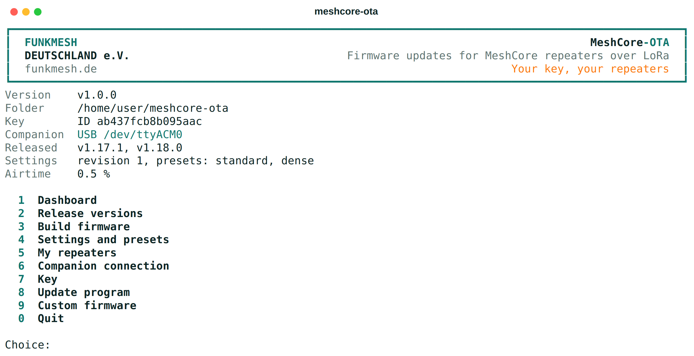
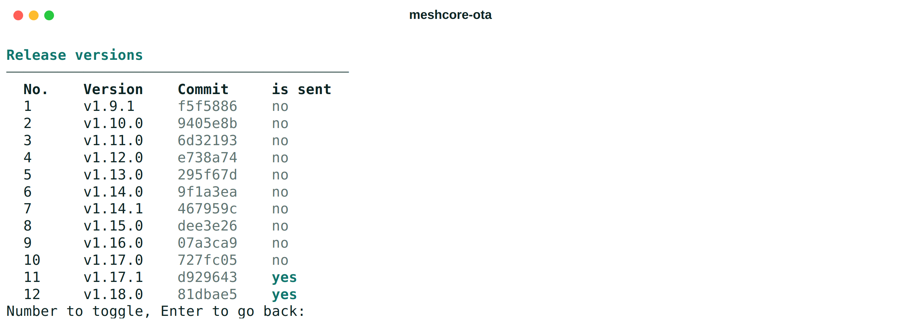
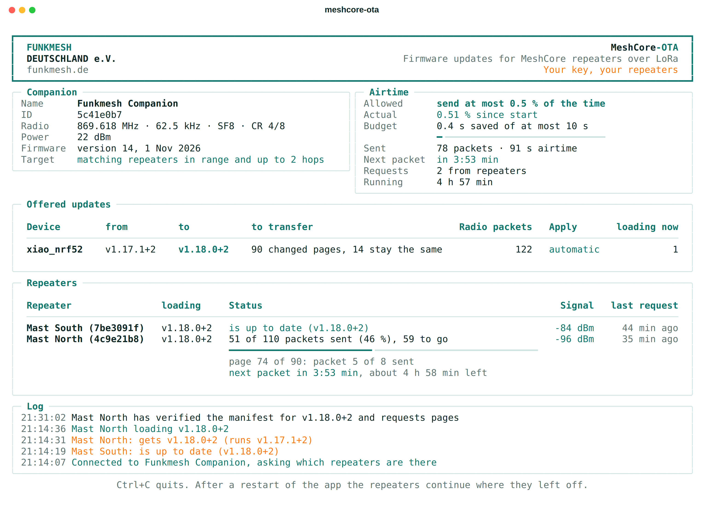

# The program meshcore-ota

`meshcore-ota` is a console program for Linux and Windows. It creates and manages the key, builds the repeater firmware from the MeshCore source code, creates and signs update packages and sends them over the air through an ordinary MeshCore companion. The companion is attached to the computer over USB or Bluetooth and needs no special firmware.

## Setup

Prebuilt executables are available in the [releases](https://github.com/funkmesh-deutschland/meshcore-ota/releases): `meshcore-ota-linux`, `meshcore-ota-linux-arm64` and `meshcore-ota-windows.exe`. Python is not required for them, except once for setting up the build tool (see [Building firmware](#building-firmware)).

From source:

```
python3 -m venv venv
./venv/bin/pip install -r tools/requirements.txt
./venv/bin/python tools/mcota.py --help
```

A standalone executable is built by `python tools/build_app.py` with PyInstaller, see [update.md](update.md).

In the following, `meshcore-ota` stands for the program, however it is started.

## Data directory

All data is stored in one folder. By default this is the directory containing the prebuilt executable, or the current directory when started from source. With `--dir <path>` before the subcommand the folder is located elsewhere:

```
meshcore-ota --dir /home/user/meshcore-ota devices
```

| Folder or file | Contents |
| --- | --- |
| `keys/signing.key` | private key as 64 hex characters. Secret |
| `keys/public.txt` | public key and key ID |
| `keys/retired-<id>.key` | retired private key after a key change |
| `keys/retired.json` | list of the retired keys (ID and public key) |
| `firmware/<device type>-<version>+<revision>.bin` | firmware builds. The basis of all packages, keep them |
| `firmware/<device type>.json` | memory layout and build information of the device type |
| `firmware/keys.json` | ID of the key each build was built with |
| `packages/<device type>-<old>__<new>.mcota` | signed packages |
| `install/` | files for the first installation |
| `downloads/` | optional: ZIP files from meshcore.io |
| `cache/` | PlatformIO environment (`venv/`), MeshCore sources (`sources/`), version list (`versions.json`), device lists, build logs |
| `settings.json` | presets and their revision |
| `releases.json` | released versions |
| `repeaters.json` | your repeaters with name, device type, position, last reported firmware and time |
| `config.json` | companion port, airtime and its upper limit, test mode, hops, web interface |
| `custom.json` | firmware source and build flags, see [custom.md](custom.md) |
| `sources/` | optional source folders, one per version, see [custom.md](custom.md) |

The device type is a short name that the firmware also reports over the air, for example `xiao_nrf52` or `rak4631`. For other devices it is derived from the name of the MeshCore environment (lower case, without `_repeater`, at most 15 characters).

The name of a build is made up of the MeshCore version and the revision of the settings, for example `v1.18.0+3`. Test firmware additionally carries `-test`.

Keep the folder `firmware`. A package only fits exactly the file that is running on the repeater. A new build of the same version can differ in small details and then no longer fits.

## The menu

```
meshcore-ota
```

without a subcommand opens the menu. On first start the program creates the folders `keys`, `firmware`, `packages` and `install` and a key pair.



Above the menu are the version, the folder, the key ID, the companion port, the released versions, the revision of the settings and the airtime.

| Menu item | What it does |
| --- | --- |
| 1 Dashboard | connects to the companion, queries for repeaters, builds and sends. Ctrl+C returns to the menu |
| 2 Release versions | shows the latest 12 repeater versions of MeshCore. Entering the number toggles a version |
| 3 Build firmware | builds the firmware with key and presets for one version and one device |
| 4 Settings and presets | create, change and delete presets, see [settings.md](settings.md) |
| 5 My repeaters | add repeaters from the companion's contacts or delete them |
| 6 Companion connection | select the port, airtime, test mode |
| 7 Key | show the key ID, import a private key, see [keys.md](keys.md) |
| 8 Update program | download a new version from GitHub, see [update.md](update.md) |
| 9 Custom firmware | firmware source and build flags, see [custom.md](custom.md) |
| 10 Web interface | port, reach and password of the web interface, see [web.md](web.md) |
| 0 Quit | |

### Release versions



The list comes from GitHub (MeshCore tags `repeater-v...`) and is cached in `cache/versions.json`. Released versions are stored in `releases.json`. As long as this file does not exist, all versions for which firmware is present in the folder count as released, plus the latest known one.

A repeater only ever receives the next released version after the one it is running. A repeater that is two versions behind first receives the next one and then the one after that. If it is already running the latest released version but the settings or the key have a newer revision, it receives the same version with the new revision.

### Build firmware

The menu asks for the version (the latest 8 are offered) and searches for the device by part of its name. The list of matches shows the processor and the support status. The result is the firmware build in `firmware/` and the files in `install/`:

| Device | File | Use |
| --- | --- | --- |
| nRF52840 | `<device>-<build>-mcota.zip` | DFU over Bluetooth (app on the phone) or USB serial |
| nRF52840 | `<device>-<build>-mcota.uf2` | USB drive of the bootloader (double press on reset) |
| ESP32 | `<device>-<build>-mcota-merged.bin` | ESP flasher over USB, starting at address 0 |
| ESP32 | `<device>-<build>-mcota.bin` | Wi-Fi update of MeshCore (`start ota`) |

If the build is already present in `firmware/`, the program does not build it again.

### My repeaters

Repeaters that have responded in the dashboard appear in the list automatically. Further ones can be added from the companion's contacts. For repeaters in this list that do not respond and whose route is unknown, the dashboard has the companion run a path discovery.

### Companion connection

The menu lists serial ports and searches for companions over Bluetooth for a few seconds. The port can also be entered by hand (`COM5`, `/dev/ttyACM0`, `AA:BB:CC:DD:EE:FF`). It then asks for the airtime of the companion in percent (0.05 to 5, default 0.5), for the upper limit it may rise to on a quiet channel (default 5) and for test mode. The values are stored in `config.json`.

The MeshCore app must not be connected to the companion at the same time. For Bluetooth, the companion has to be paired with the computer once, on Windows in the Bluetooth settings, on Linux for example like this:

```
bluetoothctl
  scan on
  pair AA:BB:CC:DD:EE:FF
  trust AA:BB:CC:DD:EE:FF
  quit
```

## The dashboard



| Panel | Contents |
| --- | --- |
| Companion | name, ID, radio parameters, transmit power and firmware of the companion |
| Airtime | the share in use and its limits, the actual share since start, the share of the channel used by others, the saved-up airtime credit of at most 10 seconds, and the time until the next packet goes out |
| Offered updates | per package: device type, source build, target build, changed pages, number of radio packets, apply mode |
| Repeaters | your repeaters and all others that have responded, with build, state, progress, signal or number of hops and time since the last report |
| Log | the latest events |

For a repeater that is loading, the status shows the progress packet by packet:

| Line | Meaning |
| --- | --- |
| `51 of 110 packets sent (46 %), 59 to go` | radio packets of this update that are sent and that are still waiting. The bar below follows this count |
| `page 74 of 90: packet 5 of 8 sent` | the page in progress. A page whose difference does not fit into one packet is split into several. Small pages share a packet, the line then counts the pages sent |
| `next packet in 3:53 min, about 4 h 58 min left` | time until the airtime credit allows the next packet, and the time for the remaining packets at the configured airtime |
| `waiting for the repeater` | everything requested is sent. The repeater checks what it has and requests what is missing |

The packet count rises again when a repeater reports packets as lost. The remaining time covers sending only. Checking, applying and the trial boot on the repeater come on top.

After the transfer the status follows what the repeater reports:

| Status | Meaning |
| --- | --- |
| `has the update completely, applies it in about 23:00 min` | the update is complete and verified. The repeater waits until no neighbour has loaded from it for a while |
| `has the update completely and waits for the command ota apply` | the package was built for applying by hand, or no rollback copy is possible |
| `is swapping the firmware` | the loader is at work |
| `runs the new firmware on trial and waits for an answer from a neighbour` | trial boot. Keep the program running, it answers the repeater |
| `is up to date` | the new build is confirmed |
| `loading from Mast North, 43 of 104 pages` | the repeater gets the update from another repeater |
| `carries a package for other repeaters, 12 of 104 pages` | the repeater collects a package it does not need itself |
| `is not reachable, offering ...` | the repeater did not answer. Its update is offered so that others can carry it there |

Below the status the dashboard names the repeater it loads from, the repeaters it serves, and its airtime share.

What the dashboard does:

1. It queries over the air which repeaters with your key are present: all in direct range, and specifically those to which a route is known. Each one reports its device type, the size and checksum of the running firmware and the name of the build.
2. It learns routes from the adverts the companion has heard and from the stored routes of its contacts. For repeaters from "My repeaters" without a known route it starts a path discovery, one at a time and at least 90 seconds apart, at most once an hour per repeater.
3. For every reported build it looks for the matching file in `firmware/` and determines the next step.
4. It builds the firmware for this step if it is missing, creates the package, signs it and offers it.
5. It only sends what is requested and keeps to the airtime.
6. It distributes the current presets as a settings package to repeaters with an older revision, see [settings.md](settings.md).
7. For repeaters from "My repeaters" that have not answered after ten minutes it offers the next update anyway, so that repeaters in range can carry it towards them.

If a repeater reports a firmware that is not present in `firmware/`, the program cannot compute a difference. The repeater then needs the firmware from this folder once (menu item 3).

With redirected output or with `--plain` the program prints plain lines instead of the dashboard.

## Range

Through the companion the computer reaches repeaters in direct range and repeaters that are up to 2 hops away. Over hops the packets travel on a fixed route, also across repeaters without MeshCore-OTA. Each packet then costs airtime for every hop. The program repeats a targeted query without a reply at most three times, and after that only again after a new advert from the repeater or when the route changes.

Repeaters further away receive the update from their neighbours. Among themselves, repeaters pass updates on to direct neighbours only (zero-hop).

The program uses hops of 2 or 3 bytes in length only if the companion firmware supports them when sending raw data (firmware version 14 or later, the dashboard shows it with the firmware of the companion). Otherwise it truncates every hop to 1 byte.

## Airtime

The companion starts at 0.5 % of the time. While it hears next to nothing from others it doubles the share every minute up to 5 %, and it falls back to 0.5 % at once when traffic appears. Both limits can be set in the menu (menu item 6) or with `--airtime` and `--airtime-max`, from 0.05 to 5 %. The same value for both keeps the share fixed.

These settings apply to the companion at the computer. The repeaters follow the same rule between 0.5 % and 5 %, the test firmware uses a fixed 5 %. Details are in [concept.md](concept.md).

While a data packet is waiting for airtime, the program holds back its offers, queries and settings notes. Each of them gets through once an hour at most.

## Subcommands

`--dir <path>` can be given before the subcommand.

### Data directory, key, program

| Command | Effect |
| --- | --- |
| `meshcore-ota init` | creates the folders and, if there is none, the key |
| `meshcore-ota key-import <file>` | imports a private key, see [keys.md](keys.md) |
| `meshcore-ota keygen <file>` | generates a single key in a file (for packages built by hand) |
| `meshcore-ota pubkey <file>` | shows the public key and key ID for a private key |
| `meshcore-ota version` | shows the version of the program |
| `meshcore-ota self-update` | downloads the latest executable from GitHub, see [update.md](update.md) |
| `meshcore-ota custom` | shows or sets the firmware source and build flags, see [custom.md](custom.md). Options: `--source`, `--device`, `--define`, `--undefine`, `--clear` |

### Devices and firmware

| Command | Effect |
| --- | --- |
| `meshcore-ota devices` | lists all repeater devices of the latest MeshCore version and whether they can be built. `--version v1.17.1` uses a specific version, `--buildable` shows only buildable ones, `--offline` does not check GitHub |
| `meshcore-ota install <device>` | builds the firmware for a device, like menu item 3. `<device>` is a name from `devices`, with or without `_repeater`, for example `RAK_4631`. Options: `--version`, `--test`, `--switch-compiler`, `--offline` |
| `meshcore-ota build [ZIP ...]` | builds firmware for ZIP files from meshcore.io. Without arguments, all from the folder `downloads`. Options: `--test`, `--switch-compiler` |

In the list printed by `devices`, `yes` stands for supported devices and `no` for unsupported ones.

### Sending

| Command | Effect |
| --- | --- |
| `meshcore-ota ports` | lists serial ports and companions over Bluetooth. `--no-ble` skips the Bluetooth search |
| `meshcore-ota repeaters --serial <port>` | lists the repeaters from the companion's contacts with a known route |
| `meshcore-ota update --serial <port>` | the same as menu item 1, without the menu |
| `meshcore-ota web` | like `update`, with plain lines instead of the dashboard and with the web interface on port 8080, see [web.md](web.md). Without a port it uses the companion from `config.json` |
| `meshcore-ota send --serial <port> <package ...>` | offers finished packages without building |
| `meshcore-ota status --serial <port> --to <repeater> --password <password>` | logs in to the repeater and queries `ota info` and `ota peers`. A custom command can be appended |

Instead of `--serial <port>` (for example `COM5` or `/dev/ttyACM0`), `--ble AA:BB:CC:DD:EE:FF` works everywhere.

Options for `update`, `web` and `send`:

| Option | Meaning |
| --- | --- |
| `--airtime <percent>` | airtime of the companion, 0.05 to 5. Default 0.5, in test mode 5 |
| `--airtime-max <percent>` | upper limit the airtime may rise to on a quiet channel, default 5 |
| `--web [PORT]` | also serve the web interface, default port 8080 |
| `--listen <address>` | address of the web interface, default `127.0.0.1` |
| `--web-password <password>` | password for the web interface |
| `--test` | test mode matching the test firmware: short intervals, 5 % airtime |
| `--plain` | plain line output instead of the dashboard |
| `--hops <0, 1 or 2>` | reach repeaters up to this many hops away, default 2. 0 means direct neighbours only |
| `--route TARGET=HOP,HOP` | route to a repeater by hand, for example `--route 1a2b3c4d=5e`. The target is the beginning of its key (4 bytes), the hops are given as hex in order starting from the companion |

Additional options for `update` and `web`:

| Option | Meaning |
| --- | --- |
| `--board <device type>` | with `--build-only`: build only this device type |
| `--offline` | do not check GitHub for new MeshCore versions |
| `--manual-apply` | repeaters do not apply on their own but wait for `ota apply` |
| `--no-rollback` | devices without room for a rollback copy apply on their own anyway, see [devices.md](devices.md) |
| `--build-only` | build and sign packages between the builds in the folder, do not send |
| `--switch-compiler` | adopt the compiler that MeshCore specifies for this version |

### Tools for tests and special cases

| Command | Effect |
| --- | --- |
| `meshcore-ota pack --key K --old old.bin --new new.bin --board <device type> --version <text> --build <number> --out x.mcota` | creates and signs a package from two firmware files. Options: `--auto-apply`, `--no-rollback`, `--basis <address>` |
| `meshcore-ota info <package>` | shows the contents of a package. With `--pubkey <hex>` the signature is verified |
| `meshcore-ota load --port <port> <package>` | loads a package onto a repeater over USB |
| `meshcore-ota load --port <port> --settings` | loads the current presets onto a repeater over USB as a settings package |
| `meshcore-ota cli --port <port> <command>` | sends a command to the repeater over USB and shows the reply. `--wait <seconds>` |
| `meshcore-ota uf2 --out x.uf2 --part address:file` | builds a UF2 file from parts. `--part address:fill=length` fills with blank bytes |

## Building firmware

The program builds every firmware itself:

1. It downloads the MeshCore source code at the commit of the selected version from GitHub to `cache/sources/`.
2. It applies the MeshCore-OTA addition and writes the public key, retired keys and the presets into the firmware.
3. It compiles with PlatformIO. For nRF52840 it additionally builds the loader.
4. It stores the build in `firmware/` and the installation files in `install/`.

Requirements: an internet connection and Python 3.9 or newer. On Windows install it from python.org, the entries from the Microsoft Store do not work. If the program does not find `pio` on the computer, it sets up PlatformIO once in `cache/venv/`. During the first build PlatformIO downloads about 1 GB. The environment variable `MCOTA_PIO` can be used to point to an existing PlatformIO. The log of a build is in `cache/build-<device>-<build>.log`.

For nRF52840 the program stays with the compiler it used to build the first firmware (recorded in `cache/compiler.txt`), even if MeshCore specifies a different one for a newer version. A compiler change alters almost every function and makes the next update correspondingly large. With `--switch-compiler` it adopts the compiler from MeshCore. For ESP32 it does not pin the compiler.

If the addition does not apply to a MeshCore version or the firmware becomes too large for the device, the build aborts with a message.

### Files from meshcore.io

Instead of selecting the version in the menu, a ZIP file from meshcore.io can specify the version, for example `Xiao_nrf52_repeater-v1.18.0-81dbae5.zip` in the folder `downloads`. The program reads the device, the version and the commit of the source code from the file name and builds exactly that. The contents of the ZIP file are not used, because a repeater needs a firmware that is built for the space behind the loader. `meshcore-ota update` and `meshcore-ota build` build everything from `downloads`.

## Commands on the repeater

The firmware adds `ota` to the MeshCore command line. The commands work over USB and, unless noted otherwise, through admin access over the air.

| Command | Effect | Access |
| --- | --- | --- |
| `ota info` | state of the repeater, see below | USB and admin |
| `ota peers` | neighbours currently loading from this repeater: ID, missing pages, seconds since the last request | USB and admin |
| `ota key` | IDs of the two key slots | USB and admin |
| `ota key set <1 or 2> <64 hex characters>` | store a public key | USB only |
| `ota key clear <1 or 2>` | remove a key | USB only |
| `ota preset`, `ota preset <name>` | show or select the preset, see [settings.md](settings.md) | USB and admin |
| `ota locksettings`, `ota locksettings on`, `ota locksettings off` | lock of the settings | USB and admin |
| `ota apply` | apply a complete update. Over the air with the update ID: `ota apply <id>` | USB and admin |
| `ota drop` | discard the update. Refused while an update is being applied (loader state `swap` or `trial`) | USB and admin |
| `ota reset` | clear the loader status. After a rollback the repeater then accepts the same update again. Refused while a swap is in progress | USB and admin, during a trial boot USB only |
| `ota hash <size>` | SHA-256 of the running firmware over this length | USB and admin |
| `ota load ...` | load a package or a settings package over USB (used by `meshcore-ota load`) | USB only |
| `ota confirm` | confirm the trial boot by hand | USB only |
| `ota ping`, `ota pong` | ping neighbours, query the reply | USB and admin |

On nRF52840, the commands `ota key set`, `ota key clear`, `ota preset <name>`, `ota locksettings on`, `ota locksettings off`, `ota apply`, `ota drop`, `ota reset`, `ota load` and `ota confirm` reply with `ERR Bluetooth is active, try later` while Bluetooth is active on the repeater (for example after `start ota`).

`ota info` replies, for example:

```
OK fw=v1.17.1+2 loading v1.18.0+2 40/93 w=40 old=0 id=0011223344556677 loader=idle from=1a2b3c4d age=12s budget=0.5% air=2.0% cfg=5 tx=31 rx=120 auto ext
```

| Field | Meaning |
| --- | --- |
| `fw` | running firmware |
| `idle`, `manifest`, `loading`, `carrying`, `ready`, `applied`, `failed` | state of the update. `carrying` means the package is collected for other repeaters |
| after that | build that is being loaded |
| `40/93` | pages present out of all pages |
| `w` | pages the repeater can pass on to neighbours |
| `old` | further packages that the repeater keeps and delivers: older ones for stragglers and carried ones for other device types |
| `id` | ID of the update |
| `loader` | `idle`, `swap`, `trial`, `confirmed`, `rollback`, `rejected` |
| `from`, `age` | provider it is loading from, and seconds since the last usable data |
| `budget` | lower limit of the airtime share |
| `air` | airtime share in use right now, by the load on the channel |
| `cfg` | revision of the settings in use |
| `tx`, `rx` | MeshCore-OTA packets sent and received |
| `auto` | applies on its own |
| `no-rollback` | no rollback copy can be created for this update |
| `awaiting-command` | waiting for `ota apply` |
| `no-sharing` | the package does not fit into the store used for passing it on |
| `ext` | the package store is in the external flash |
| `direct` | ESP32: switch by changing the boot partition |
| `FLASH-BLOCKED` | a write access was rejected. Appears directly after `OK` |
| `PAUSED` | nRF52840: Bluetooth is active, MeshCore-OTA rests until the next restart. Appears directly after `OK` |

## Limitations

- A package only fits one device type and exactly one source firmware.
- At 0.5 % airtime an update takes hours per repeater, correspondingly longer over hops, see [concept.md](concept.md).
- The program has to run until the first repeater has everything. After that, this repeater distributes the update further itself.
- A jammer in radio range can stall a transfer but cannot inject anything false.
