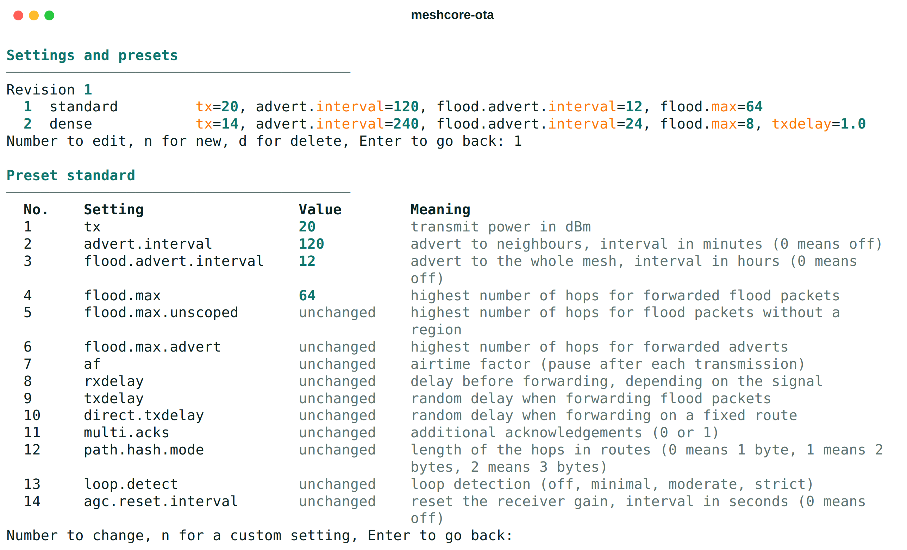

# Settings and presets

With `meshcore-ota` you give your repeaters a set of basic settings. They are part of the firmware and are distributed with every update.



## What a preset is

A preset is a named list of settings, for example `standard` for most repeaters and `dense` for repeaters with many neighbours. Each setting corresponds to a MeshCore `set <name> <value>` command. Anything the respective MeshCore version knows through `set` can be prescribed this way. The menu (menu item 4) suggests these:

| Setting | Meaning |
| --- | --- |
| `tx` | transmit power in dBm |
| `advert.interval` | advert to neighbours, interval in minutes (0 means off) |
| `flood.advert.interval` | advert to the whole network, interval in hours (0 means off) |
| `flood.max` | maximum number of hops for forwarded flood packets |
| `flood.max.unscoped` | maximum number of hops for flood packets without a region |
| `flood.max.advert` | maximum number of hops for forwarded adverts |
| `af` | airtime factor (pause after each transmission) |
| `rxdelay` | delay before forwarding, depending on the signal |
| `txdelay` | random delay when forwarding flood packets |
| `direct.txdelay` | random delay when forwarding on a fixed route |
| `multi.acks` | additional acknowledgements (0 or 1) |
| `path.hash.mode` | length of the hops in routes (0 means 1 byte, 1 means 2 bytes, 2 means 3 bytes) |
| `loop.detect` | loop detection (`off`, `minimal`, `moderate`, `strict`) |
| `agc.reset.interval` | readjust the receiver, interval in seconds (0 means off) |

With `n` any other setting can be entered in the menu under its name from the `set` command. Only settings with a value are set. Everything else stays on the repeater as it is.

Rules:

- At most 8 presets.
- The name of a preset has 1 to 15 characters from a to z, digits, `-` and `_`.
- Values may contain letters, digits and the characters `. , : _ + -`, at most 40 characters.
- Name, location, passwords, owner information and the private key of the repeater cannot be included in a preset.

The last rule has two reasons: all repeaters of a device type carry bit-identical firmware, otherwise no update fits. Whatever differs per device therefore stays in the settings storage of the device. In addition, the contents of the firmware would be readable by anyone over the air.

The presets are stored in `settings.json` in the data directory:

```
{
  "revision": 3,
  "digest": "...",
  "presets": [
    {"name": "standard", "values": {"tx": "20", "advert.interval": "120"}},
    {"name": "dense", "values": {"tx": "14", "flood.max": "8"}}
  ]
}
```

## On the repeater

All presets are part of every firmware. Each repeater remembers for itself which one applies. Without a selection of its own, the first preset in the list applies.

| Command | Effect |
| --- | --- |
| `ota preset` | shows the active preset, whether it has been applied, the lock, the number of errors and the list |
| `ota preset <name>` | switches to this preset and applies it immediately |
| `ota locksettings on` | the repeater keeps its values, updates no longer overwrite anything |
| `ota locksettings off` | removes the lock |
| `ota locksettings` | shows the lock |

The commands work over USB and through admin access over the air. The reply to `ota preset` looks like this, for example:

```
OK active=standard state=applied lock=off errors=0 list=standard,dense
```

On nRF52840, preset and lock cannot be changed while Bluetooth is active on the repeater (for example after `start ota`). The repeater then replies with `ERR Bluetooth is active, try later`. The same applies to all other `ota` commands that write, see [app.md](app.md).

## When values are overwritten

A repeater applies its preset

- a few seconds after the first start of a firmware with presets,
- after an update, if the active preset has different values in it,
- when you switch with `ota preset <name>`.

In between you can change individual values on the repeater by hand. They stay until the active preset arrives with changed values. With `ota locksettings on` they stay even then. A switch with `ota preset <name>` always takes effect, even with the lock set.

If the selected preset no longer exists in a new firmware, the first one in the list applies again.

If a MeshCore version does not know a setting, the repeater counts that as an error and sets the rest. `ota preset` shows the number of errors.

## How changes are sent out

Every change to a preset or to the key results in a new revision. The same happens when a new version of the program brings changes to the MeshCore-OTA part of the firmware, so that fixes there reach repeaters that are already installed. It follows the version in the name of the firmware, for example `v1.18.0+4`. The dashboard builds the running version with the new revision and sends the difference to the previous firmware. The update is small because essentially only the table of presets changes.

For a new revision the same applies: the repeater only receives it once it is running the latest released version. If it is one version behind, it receives the next version together with the current revision.

## The key

The public key is part of the firmware as well. Details are in [keys.md](keys.md).
