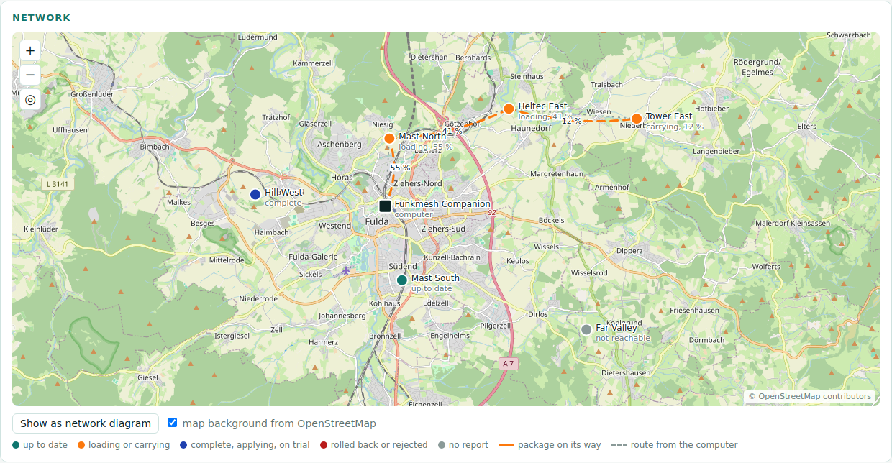
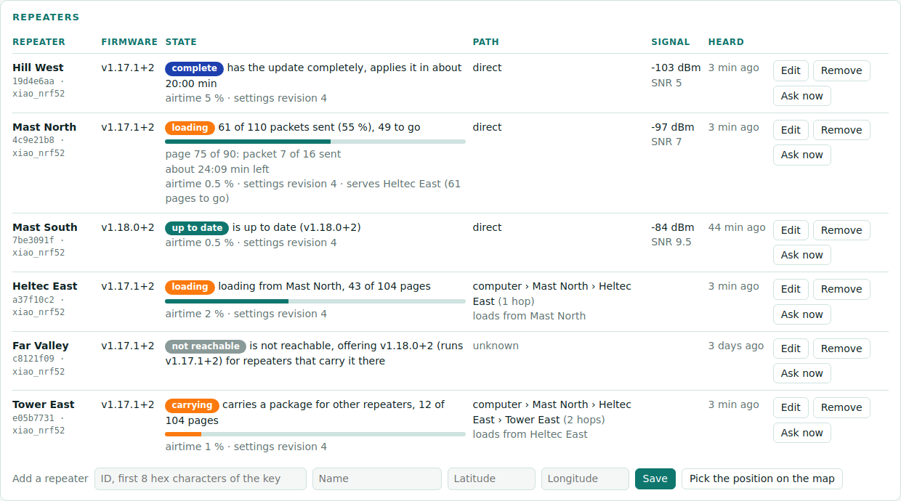

# Web interface and running as a service

`meshcore-ota` can show its state in a browser and run without an open console, for example on a Raspberry Pi next to the companion.



## Starting it

```
meshcore-ota web
```

does the same as `meshcore-ota update` (query, build, sign, send), prints plain lines instead of the dashboard and serves the web interface on port 8080. Open `http://localhost:8080/` on the same computer.

Without `--serial` or `--ble` the command uses the companion, the airtime and the test mode stored in `config.json` by menu item 6.

| Option | Effect |
| --- | --- |
| `--web [PORT]` | for `update`: also serve the web interface. For `web`: another port than 8080 |
| `--listen ADDRESS` | address to listen on. The default `127.0.0.1` only accepts the computer itself. `0.0.0.0` accepts other devices in the network |
| `--web-password PASSWORD` | the browser asks for this password. The user name does not matter |

Menu item 10 stores port, reach and password in `config.json`. The dashboard (menu item 1) then serves the web interface as well.

The connection is not encrypted and the password travels with every request. Open the interface to your own network only.

## What it shows

| Area | Contents |
| --- | --- |
| Companion | name, ID, radio parameters, firmware, and the settings package that is being distributed |
| Airtime | the share in use right now and its limits, the share actually used, how busy the channel is with other traffic, and the time until the next packet |
| Network | the map or the network diagram |
| Repeaters | the list of your repeaters and of all others that have reported |
| Offered updates | the packages on offer |
| Log | the latest events |

### Network

The map shows the computer and the repeaters at their positions. A dotted grey line is the route the computer uses to reach a repeater. A dashed orange line is a package on its way from one station to the next, with the progress next to it.

The colour of a repeater tells its state:

| Colour | State |
| --- | --- |
| teal | up to date |
| orange | loading, or carrying a package for others |
| blue | has the update completely, is applying it, or runs it on trial |
| red | rolled back, or the loader rejected the update |
| grey | no report, or not reachable |

Positions come from the location a repeater sends in its adverts, as far as the companion has it among its contacts. A position entered in the list takes precedence. Repeaters without a position are lined up at the bottom of the map.

"Show as network diagram" arranges the stations by their distance from the computer instead. This view needs no positions.

The map background is loaded by the browser from the servers of OpenStreetMap. The checkbox below the map switches it off. Without an internet connection the stations and lines are drawn on an empty background.

### Repeaters



| Column | Contents |
| --- | --- |
| Repeater | name, ID and device type |
| Firmware | the build the repeater last reported |
| State | what the repeater is doing, with progress, the page in transfer, the time until the next packet and the remaining time. Below that the airtime share the repeater uses, its settings revision, and the repeaters it serves |
| Path | the route from the computer, and the repeater it loads from if that is not the computer |
| Signal | signal strength of the last packet heard directly |
| Heard | time since the last report or request |

The states in the list:

| State | Meaning |
| --- | --- |
| loading | receives an update, from the computer or from another repeater |
| carrying | collects a package it does not need itself and hands it on |
| waiting | everything requested is sent, or the package is being built |
| complete | has the update completely. With automatic apply the time until then is shown |
| applying | is swapping the firmware |
| on trial | runs the new firmware and waits for an answer from a neighbour |
| up to date | runs the latest released build |
| rolled back, rejected | the update was undone or refused, see [concept.md](concept.md) |
| not reachable | did not answer. Its update is offered for repeaters that can carry it there |
| no report | entered in the list, nothing heard yet |

Buttons:

- **Edit** fills the form below the list with the entry. There you change the name and the position. "Pick the position on the map" takes the next click on the map as the position.
- **Add to my repeaters** does the same for a repeater that reported but is not in your list.
- **Remove** takes the repeater off the list.
- **Ask now** sends a query to this repeater without waiting for the next regular one.

A repeater can also be entered by hand with the first 8 hex characters of its key. For repeaters in your list the program looks for a route by itself, see [app.md](app.md).

## Programming interface

The page reads everything from one address and sends changes to three more. They can be used by other programs.

| Request | Contents |
| --- | --- |
| `GET /api/state` | the complete state as JSON: `companion`, `airtime`, `settings`, `packages`, `repeaters`, `links`, `log` |
| `POST /api/repeater` | add or change an entry: `{"id": "4c9e21b8", "name": "Mast North", "lat": 50.58, "lon": 9.68}`. Without `lat` and `lon` the position is removed |
| `POST /api/remove` | `{"id": "4c9e21b8"}` |
| `POST /api/query` | `{"id": "4c9e21b8"}` |

`POST` requests need the header `Content-Type: application/json`.

## As a service on Linux

Example for systemd with the program in `/opt/meshcore-ota`. Choose the companion once with `./meshcore-ota` and menu item 6, then create `/etc/systemd/system/meshcore-ota.service`:

```
[Unit]
Description=MeshCore-OTA
After=network-online.target

[Service]
WorkingDirectory=/opt/meshcore-ota
ExecStart=/opt/meshcore-ota/meshcore-ota web --listen 0.0.0.0 --web-password change-me
Restart=on-failure
RestartSec=30
User=meshcore

[Install]
WantedBy=multi-user.target
```

```
sudo systemctl enable --now meshcore-ota
journalctl -u meshcore-ota -f
```

The user of the service needs access to the serial port of the companion (on most systems the group `dialout`) and write access to the folder. On a Raspberry Pi with a 64-bit system use `meshcore-ota-linux-arm64`.

Repeaters keep what they have loaded. After a restart of the service they continue where they left off.
